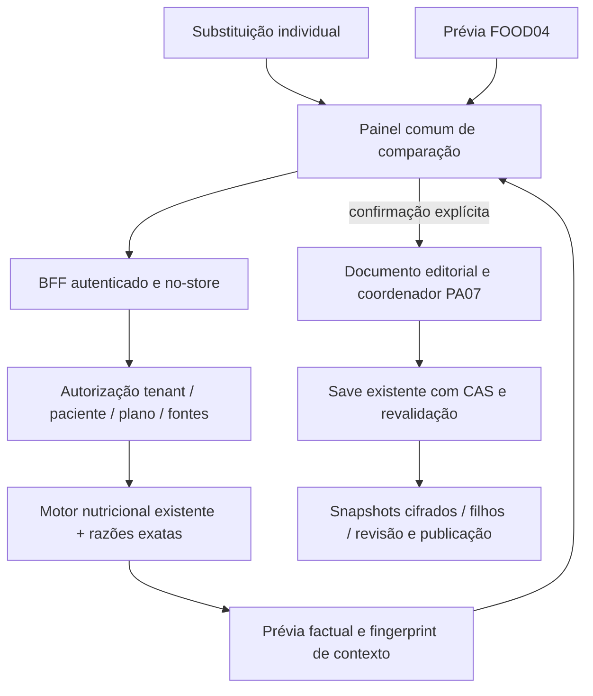

# FOOD05 — plano de implementação: equivalência por nutriente

> Execução autorizada: `superpowers:executing-plans`, tarefa por tarefa.
> A autorização de desenvolvimento não abrange migrations externas, merge, deploy
> ou infraestrutura. Preservar os gates e todas as melhorias M01–M08.

**Objetivo:** comparar porções alternativas por um único nutriente e confirmar
sua aplicação no editor individual e na FOOD04, com M01–M08 completas.
**Arquitetura:** cálculo determinístico no backend, integrado ao motor existente;
prévia sem escrita, intenção mínima validada novamente no save, fatos cifrados
imutáveis e preferências próprias do profissional.
**Stack:** NestJS/TypeORM/PostgreSQL/RLS; Next/React/BFF; BigInt nativo; Jest/Playwright.
**Especificação:** mensagem integral do proprietário “OCTACLIN — FOOD05:
Equivalência por Nutriente”, de24/10/2026, consolidada em D01–D14 e M01–M08 abaixo.
**Estado:** implementação autorizada pelo proprietário em “Pode seguir, sol médio”.
Progresso real e evidências em [execucao-pos-320-food05.md](execucao-pos-320-food05.md).
Autorização não abrange merge, deploy, infraestrutura ou migrations externas.
**Base:** main `2f24fcb1` (inclui #441/#439/#432); branch
`docs/pos320-food05-planning`, worktree `pos320-food04-planning` reaproveitada,
limpa antes de iniciar. Registro operacional FOOD04 preservado de43345453,
cherry-pick documental47ed21f2. Não confundir o nome físico da worktree com a fase.

## 1. Contratos de produto aprovados

| Decisão | Contrato obrigatório |
| --- | --- |
| D01 | Exatamente energiaKcal, proteinasG, carboidratosG ou gordurasG; um alvo por operação |
| D02 | Individual e grupos FOOD04 usam o mesmo serviço/backend e validações |
| D03 | Recalcular explicitamente, seleção parcial, prévia e cancelamento; nunca automático |
| D04 | M01–M08 são essenciais; PR intermediária não encerra FOOD05 |
| D05 | Identidade exata/preparo/fonte/base/versão, sem fusão por nome ou fator de cocção |
| D06 | Porção matemática, sugerida, editada e confirmada distintas; resíduos visíveis |
| D07 | Simulação de refeição substitui uma contribuição; não soma principal e alternativa |
| D08 | Grupos não são alterados; alternativas novas sem preferência/liberação ao paciente |
| D09 | Snapshot, histórico, autosave60s, PA07, idempotência/CAS e isolamento preservados |
| D10 | Sem inferir ausentes, densidade ml/g, alergias ou equivalência clínica completa |
| D11 | Preferências por profissional; nenhuma mudança silenciosa em valores persistidos |
| D12 | Só fontes disponíveis/autorizadas; TBCA continua NO-GO; sem scraping/importação nova |
| D13 | Sem micronutrientes-alvo, IA, chamadas externas/pagas, otimização multinutriente |
| D14 | FOOD04 produção segue bloqueada; quota/cobrança/infra/migration produtiva sem autorização |

### Restrições globais de engenharia

- Preservar teto20 substituições/item,50 refeições,100 itens/refeição e96KiB/documento;
  não elevar body parser100KiB nem descartar linhas para caber.
- FOOD04/FOOD01 aceitam porções0,001–10.000g e até3 casas; FOOD05 usa o mesmo
  domínio técnico de aplicação. Fora dele, explicar sem truncar/clamp silencioso.
- Novas prévias: até20 alternativas por pedido, incluindo recalculadas; paginação
  de busca continua existente. Comparar20 não permite inserir além da capacidade restante.
- Nenhuma dependência instalada neste planejamento. Produção não consultada novamente.
- Dados/snapshots/fingerprints de contexto não entram em URLs, logs, métricas, cache
  persistente ou auditoria. DTOs explícitos, sem ORM bruto e sem object spread público.

## 2. Inventário real e gaps

Paths backend relativos a `octaclin-backend/src/modulos/planos-alimentares/`;
Web relativos a `octaclin-web/`. Os arquivos citados foram lidos/pesquisados nesta rodada.

| Superfície existente | Reutilização e mudança localizada |
| --- | --- |
| `dominio/calculo-nutricional.ts` | Motor de porção atual; arredonda4, float+epsilon, exige4 macros. Estender política aritmética explicitamente versionada para FOOD05, sem trocar defaults legados |
| `dominio/micronutrientes.ts` | Já possui razão decimal BigInt/half-up/normalização escala8; extrair aritmética genérica sem expor micronutrientes como alvos |
| `dominio/edicao-plano.ts` | Documento schema1 fechado/96KiB, chaves únicas; acrescentar intenção opcional estrita de equivalência, sem aceitar resultados calculados do cliente |
| `aplicacao/servico-planos-alimentares.ts` | Autorização/carteira, transações, CAS, materialização, revisão/publicação, clone; manter como orquestrador, helpers novos focados |
| `aplicacao/snapshot-edicao-grupos.ts` | Envelope interno2 cifrado e catálogo preservado; estender reader para envelope3 com mapa equivalências, mantendo schema1/envelope2 legíveis |
| `aplicacao/origens-grupos-materializadas.ts` | Hidratação de filhos autorizados no clone; reutilizar padrão para contexto FOOD05 sem capability copiada entre pacientes |
| `aplicacao/fontes-grupos-substituicoes.ts` | Resolve catálogo/custom/autorização/direitos; resposta atual de catálogo omite preparo e base original, completar projeção permitida, não inferir pelo nome |
| `aplicacao/projecao-composicao.ts` | Hoje catálogo faz spread ao retirar origemGrupo; corrigir fronteira explicitamente para NÃO expor novo contexto FOOD05 ao portal/PDF |
| `dominio/medidas-caseiras.ts`, `aplicacao/servico-medidas-caseiras.ts` | Cálculo exato em milésimos, vínculos/revisões/fonte; reutilizar conversão e resolver autorizado, sem inventar unidades |
| `infraestrutura/plano-alimentar-versao.orm.ts` | Ciphers editoriais, cálculo, totais e identidades; não criar tabela de cálculo/sessão de prévia |
| `infraestrutura/plano-alimentar-substituicao.orm.ts` | Cipher de composição/versão motor por filho; carregar proveniência FOOD05 no JSON interno para publicação/clone/modelos |
| Web `lib/nutricao-plano.ts` | `nutrientesDaPorcao` legado transforma faltantes em zero: NÃO usar em FOOD05. Subtotal estrito PA03 oferece semântica de parcial; manter zeros legados fora da ferramenta |
| Web `components/pacientes/plano-alimentar-profissional.tsx` | Integração mínima nos callbacks e formulário; não adicionar todo painel ao arquivo já muito grande |
| Web `components/pacientes/aplicar-grupo-substituicoes.tsx`, `lib/aplicacao-grupo-substituicoes.ts` | Prévia, dedup, seleção, AbortSignal/undo; usar o painel comum de equivalência com origemGrupo preservada |
| Web `lib/coordenador-edicao-plano.ts`, `lib/usar-coordenacao-abas-plano.ts` | Autosave, ACK em voo, posse/transferência PA07 e navegação; mesmo guard antes/depois de await |
| Web `lib/server/sessao-bff.ts`, `lib/plano-alimentar-api.ts` | Sessão/permissões, renovação/erros, no-store; registrar novas rotas no catálogo/testes, sem proxy paralelo |
| `profissionais/infraestrutura/profissional.orm.ts` | Sem preferências genéricas atuais. Proposta de2 colunas para M08, não nova tabela |
| `notificacoes/.../preferencia-notificacao-usuario.orm.ts` | Especializada em digest/timezone; NÃO usar para nutrição |
| `tenancy/.../tenant-configuracao.orm.ts` | Chave/JSON por tenant, não configuração pessoal; NÃO gravar preferências de todos os usuários nesse JSON |

### Divergências e resolução técnica proposta

| Gap | Evidência | Resolução recomendada, sujeita à revisão deste plano |
| --- | --- | --- |
| G-01 precisão | float e normalização4 na composição atual | Política decimal-racional versionada dentro do motor; snapshots antigos continuam intactos; defaults legados não mudam |
| G-02 parcial | materialização exige energia+3 macros | Prévia calcula alvo disponível e mostra demais como ausentes; aplicação exige composição materializável pelo contrato atual, explicando o motivo. Não preencher zeros para contornar |
| G-03 preparo | resumo FOOD04 catálogo sem preparacao/base | Resolver exato retorna metadados autorizados; ausente fica “preparo não informado”, nunca inferido |
| G-04 persistência | envelope2 e snapshots de filhos, sem FOOD05 | Envelope3/metadata cifrada em colunas existentes, leitor retrocompatível; writers legados bloqueados se apagariam proveniência |
| G-05 preferências | sem infraestrutura pessoal genérica |2 colunas no profissional, CAS e RLS existentes; migration1079 provisória, reconferir numeração antes de criar |
| G-06 projeção | spread catálogo pode vazar campos futuros | DTO interno/profissional separado de projeção pública por allowlist explícita; testes contra campos aninhados extras |
| G-07 alvo somente parcial | snapshot completo pode estar indisponível | “Calculável para conferência / indisponível para aplicar” distintos; nenhum dado perdido no rascunho incompleto |
| G-08 produção | FOOD04 1078 não aplicada; HTTP402/deploy falho | Bloqueio de rollout FOOD05; planejamento e testes locais sintéticos são independentes; não regularizar quota automaticamente |

## 3. Arquitetura escolhida e alternativas

**Recomendada:** domínio puro de razão/porção + adaptador no motor nutricional
atual + `ServicoEquivalenciasPlano` somente leitura para prévia e validação
interna no save existente. Frontend individual e FOOD04 compartilham painel/API.
Nenhuma sessão de prévia persistida, tabela de cálculo, fila ou inferência externa.

Alternativas avaliadas:

1. Motor só no navegador: barato inicialmente, mas duplica autorização/composição,
   diverge do materializado e permite adulteração. Rejeitado como autoridade.
2. Backend puro integrado (escolhido como proposta técnica): precisão e fontes
   únicas, rastreabilidade/validação repetida; depende da API durante edição.
3. Serviço separado + biblioteca decimal/novas tabelas: desnecessário para o
   escopo, aumenta dependências e superfície de autorização. Não recomendado.

### Contratos propostos, nomes fixados para o handoff

- `NutrienteEquivalencia = 'energiaKcal'|'proteinasG'|'carboidratosG'|'gordurasG'`.
- `calcularEquivalencia(entrada: EntradaEquivalencia): ResultadoEquivalencia`:
  função pura em `dominio/equivalencia-nutriente.ts`; recebe fatos canônicos
  resolvidos pelo servidor, bases/unidades, porção e política; NÃO recebe usuário.
- `normalizarComposicaoDecimal(origem: ComposicaoDecimalOrigem): ComposicaoCanonicaDecimal`
  e política opcional `racional-v1` na API do motor em `calculo-nutricional.ts`.
- `simularTrocaNaRefeicao(itens: FatosItemRefeicao[], chavePrincipal: string,
  alternativa: FatosItemRefeicao): ImpactoRefeicao`: motor existente/semântica
  estrita; cenários independentes por alternativa, sem tocar formulário.
- `ServicoEquivalenciasPlano.prever(tenantId, pacienteId, planoId, usuario,
  dto: PreverEquivalenciasDto): Promise<PreviaEquivalenciasDto>`.
- `resolverEquivalenciasDocumento(...)` em `aplicacao/resolver-equivalencias-edicao.ts`:
  usa contexto confiável anterior, fatos atuais autorizados e intenções; gera
  mapa interno, porções e estados de revisão. Consumido só pelo save existente.
- `projetarEquivalenciasProfissional(contextos): EquivalenciasAplicadasDto`:
  projeção mínima, somente no editor profissional autorizado.
- `ServicoPreferenciasEquivalencia.obter(usuario)` /
  `atualizar(usuario, dto: AtualizarPreferenciasEquivalenciaDto)` com CAS.

Tipos auxiliares são contratos a implementar em
`dominio/equivalencia-nutriente.ts`, `dominio/preferencias-equivalencia.ts` e
`aplicacao/dtos-equivalencias.ts`, não entidades ou novos modelos de composição.
`EntradaEquivalencia` contém principal/alternativa (`FatosComposicao` com identidade,
preparo, base, valores por nutriente, fonte/hash/revisão), porção principal,
porção editada opcional e política numérica. Campos ausentes são opcionais explícitos.

### API de prévia

`POST /pacientes/:pacienteId/planos-alimentares/:planoId/equivalencias/previa`
(BFF espelha sob `/api`, dados só no corpo, não query string).

Entrada estrita: `{versaoId, rascunhoRevisaoEsperada, documentoEdicao,
itemChave, nutriente, alternativas[<=20], politica}`. Cada alternativa contém
chaveCliente, referência de origem catalogo/custom/manual e porção editada
opcional; entrada de grupo também contém sua intenção FOOD04/revisão/entrada.
A mesma rota atende novo cálculo e recálculo. Não aceitar fonte/tenant/profissional
arbitrários nem snapshots de resultado do cliente. Valores manuais seguem o
contrato já permitido ao editor, com origem manual visível.

O documento pode conter edições locais não salvas: backend valida96KiB,
identidades/escopo, resolve referências e compõe apenas em memória. Corpo completo
continua <=96KiB (parser100KiB); excedente retorna413 sem descarte. Não exigir save
para abrir uma prévia; instabilidade/indisponibilidade impede confirmar cálculo novo.

Saída: nutriente/unidade, principal factual, fingerprint, revisão observada,
resultado por alternativa (`calculavel|indisponivel`), `aplicavel` separado,
porções matemática/sugerida/editada, nutrientes e resíduos, impacto hipotético,
medidas disponíveis e avisos com códigos estáveis. Sem corpos de grupos, ciphers,
IDs internos de outro paciente ou mapas de contexto. Falhas globais usam400/403/404/
409/413; falha de uma alternativa é resultado individual, não500 do conjunto.

Fingerprint serve apenas à consistência, nunca como autorização. Derivado no backend
com identidade tenant/usuário/profissional/paciente/plano/versão/pai/filho, fatos, revisão editorial,
política e alvo. Comparar de novo no save; não gravar no log/auditoria. É opaco no
cliente, memória da aba apenas; não é capability portátil para outro plano/usuário.

## 4. Fórmulas, unidades e precisão

Para bases explícitas em gramas `Bp`, `Ba`, porção principal `P`, valores originais
`Vp`, `Va`: `T=P*Vp/Bp`; `Qmath=T*Ba/Va`. No caso normalizado100g resulta
na fórmula aprovada. Não arredondar para100g e depois novamente para calcular a
razão quando houver origem disponível. Para snapshot legado sem origem bruta,
usar exatamente sua composição canônica salva, identificando a precisão herdada.
Não reconstruir casas decimais que o histórico perdeu.

**Política `equivalencia-nutriente-v1`:** razões decimais BigInt, reduzidas por MDC;
parsing limitado (até64 caracteres internos/32 no input HTTP, expoente interno
compatível e limitado ao domínio numérico das fontes). Sem float nas operações
intermediárias. Campos nutricionais atuais numeric16,8 e base12,3 são limites
verificados, não convite a expoentes/cadeias gigantes. Validar antes de multiplicar.

- Armazenar razões como numerador/denominador decimais em strings no contexto
  interno, mais bases/valores originais realmente usados; BigInt não sai em JSON.
- `Qmath` é razão exata, potencialmente periódica; apresentar aproximação com até
 8 casas e “≈” quando necessário, detalhes reproduzíveis, sem prometer número finito exato.
- `Qsugerida=roundHalfUp(Qmath/passo)*passo`; passo padrão1g, opções1/0,1/0,01/0,001g.
  Não fazer clamp: arredondou0 ou saiu dos limites, bloquear aplicação e permitir
  passo menor/edição explícita. O cálculo matemático continua consultável.
- Porção efetiva `Qconfirmada`: positiva0,001–10.000g, até3 casas. A cada edição,
  recomputar no mesmo motor backend; não arredondar novamente uma porção já confirmada.
- Obtenção exata `O=Qconfirmada*Va/Ba`; `delta=O-T`; diferença absoluta `abs(delta)`;
  percentual assinado `100*delta/T` somente T>0. Zero-alvo nunca produz percentual0 falso.
- Nutrição aplicada e simulação usam a mesma política decimal do motor existente:
  normalização canônica até8 casas quando necessária; saída de nutrientes de porção
  mantém4 casas do contrato atual. Guardar também os resíduos matemáticos não
  arredondados, identificando diferença entre número materializado e comparação exata.
- Não trocar o default legado de `calcularNutrientesDaPorcao` nem motor global='1':
  estender política explícita usada por FOOD05, com fixtures legadas invariantes.
  Filhos novos identificam a política `nutricao-decimal-v1` no campo de versão já
  existente; metadados do cálculo guardam ambas as versões. A versão global da
  fórmula energética não muda para invalidar snapshots antigos indevidamente.
- Confirmar salva os nutrientes correspondentes a Qconfirmada e à política que a
  prévia mostrou. Se materializado4casas e exato divergem abaixo da apresentação,
  exibir diferença não nula como “<0,0001” com detalhes, não “0/igual”.
- Valores de energia são kcal; macros são g. Não calcular kcal por4/4/9 quando a
  energia da fonte estiver ausente. Não converter kJ/ml/unidades sem equivalência
  explícita validada da fonte/cadastro; FOOD05 não inventa normalização nova.

### Casos especiais e disponibilidade por indicador

| Entrada | Resultado/ação |
| --- | --- |
| Principal/porção/base ausente, nula ou <=0 | Indisponível com campo e motivo; preservar formulário |
| Alvo ou concentração ausente | Ausente, não zero; permitir outro alvo/alimento |
| Valor negativo/não finito/formato inválido | Erro de validação; nunca emitir NaN/Infinity |
| T>0, Va=0 conhecido | Equivalência impossível |
| T=0, Va=0 conhecido | Indeterminada: não existe porção positiva única |
| T=0, Va>0 | Solução matemática0g, fora de aplicação positiva; não sugerir alternativa equivalente |
| Valor positivo perdido ao normalizar snapshot legado | Limite de precisão herdado explícito, não reinterpretar como zero conhecido |
| Outros macros ausentes | Calcular alvo válido e indicadores independentes; demais “—”; aplicação bloqueada se materialização atual exigir composição completa |
| Qmath fora do domínio de porções | Mostrar cálculo/aviso, sem clamp; porção manual válida pode ser comparada e confirmada com seu resíduo explícito |
| Unidades incompatíveis/base sem g confiável | Indisponível, sem densidade presumida |
| Fonte/preparo/revisão mudou durante operação |409 e nova prévia; nenhuma alteração parcial |

### Exemplos sintéticos fixados antes dos testes futuros

- Energia: P150g, Vp200kcal/100g, Va120kcal/100g => T300kcal, Q250g, resíduo0.
- Proteína: P75g,Vp20g/100g,Va12g/100g => T15g,Q125g.
- Carboidrato: P80g,Vp30g/100g,Va24g/100g => T24g,Q100g.
- Gordura: P50g,Vp10g/100g,Va25g/100g => T5g,Q20g.
- Base diferente: P75g,Vp10g/50g,Va6g/30g => T15g,Q75g.
- Periódico: P100g,Vp10g/100g,Va3g/100g => Q1000/3g;
  passo1g dá333g,O9,99g,delta−0,01g,abs0,01g,percentual−0,1%.
- Limites half-up:2,5g com passo1 =>3g;0,0005g com passo0,001=>0,001g
  matematicamente, mas explicitar que Qmath era abaixo do domínio; nunca inferir adequação.
- Refeição: principal300kcal, outro50kcal; alternativa250kcal => antes350,
  depois300,delta−50; não600 e não considerar todas as alternativas simultâneas.

## 5. M01–M08: comportamento e aceite objetivo

| Item | Implementação essencial | Aceite que bloqueia conclusão |
| --- | --- | --- |
| M01 preparo | Identidade+preparacao+fonte/revisão/base na prévia e snapshot; resolver complementa metadados faltantes FOOD04 | Cru/cozido IDs distintos não fundem; preparo ausente rotulado; nome semelhante não seleciona nem converte; histórico preserva identificação |
| M02 medidas | Resolver FOOD01 por alimento/preparo/escopo, converter exatamente pelo peso cadastrado; revisão congelada | Medida válida mostra Qg e quantidade; outra preparação/tenant/inativa para nova aplicação negada; ausente mostra só g; ml só se cadastro confiável g↔quantidade |
| M03 resíduos | T,O,Qmath,Qsugerida,Qconfirmada,delta/abs/% e versão; nova comparação após edição | Exemplo periódico correto; resíduo não nulo nunca some por formato; payload/aplicado correspondem a Qconfirmada |
| M04 refeição | Simular cada alternativa retirando principal e mantendo demais; totais parciais explícitos | Exemplo350→300; principal não alterado; nenhuma soma cumulativa das alternativas; preview não muda total efetivo do plano |
| M05 praticidade | Avisos matemáticos objetivos detalhados abaixo, não clínicos | Bordas/razão/passo testados; limites técnicos separados de aviso; nenhum diagnóstico/limiar de adequação ao paciente |
| M06 simultânea | Até20 alternativas, seleção/edição por linha, mesmo painel individual/FOOD04; cenários independentes | Seleção parcial só aplica escolhidas; cancelamento zero efeitos; grupo original inalterado; comparações acessíveis desktop/mobile |
| M07 revisão | Dependências semânticas no snapshot, invalidadores explícitos, ação recalcular/manter como manual | Porção/identidade/fatos/parâmetro/medida efetiva mudados pendem; texto/layout não; nenhuma atualização retroativa ou perda por omissão de cliente antigo |
| M08 preferências | Configuração pessoal no servidor/CAS; gramas sempre canônicas; defaults e distinção visual/aplicada abaixo | Reabre em outra sessão; outro usuário não lê/edita; formato não altera porção salva; passo só afeta nova sugestão/prévia confirmada |

### M05 — proposta objetiva antes de implementar

Não foi localizada regra clínica de porção prática reutilizável. Proposta de UX
versionada `praticidade-v1`, para revisão do proprietário:

1. Avisar quando Qmath for menor que o passo escolhido ou arredondar para0.
2. Avisar quando razão Qmath/P >=10 ou <=0,1 (uma ordem de grandeza), mostrando
   o fator real e as duas massas. É um critério de comparação matemática, NÃO
   limite clínico ou conclusão de que a porção é inadequada.
3. Fora de0,001–10.000g: explicar limite técnico e impedir aplicação inválida;
   não misturar bloqueio de domínio com simples aviso.

Copy: “A porção calculada pode ser pouco prática. Verifique sua aplicabilidade
antes de confirmar.” Acompanhado da causa numérica, sem inventar regra por alimento,
idade, condição ou paciente. Avisos não bloqueiam uma porção válida nem exigem
um segundo consentimento; a confirmação explícita já apresenta o contexto.
Se o proprietário rejeitar o critério2, substituir por outro critério objetivo
aprovado antes de codificar, sem retirar M05 do escopo.

### M02 — inversão e medida efetivamente aplicada

Qg * quantidadeReferencia / pesoReferenciaGramas fornece a quantidade doméstica.
Mostrar aproximação, referência/revisão e precisão; não escolher “colher” ou
“xícara” por heurística. Usar primeira medida já aplicada ao mesmo alimento como
sugestão; caso contrário, o profissional escolhe entre as disponíveis autorizadas.
Gramas permanecem padrão quando não há uma escolhida.

Exibir “≈2,5 colheres” não muda Qg. Se o profissional escolher aplicar pela medida,
o peso efetivo é recalculado por `calcularPesoMedida`, atualiza nutrientes/resíduos
e exige confirmação. Não gravar quantidade doméstica arredondada com gramas
incompatíveis; a referência/revisão via FOOD01 acompanha a aplicação.

### M08 — proposta de defaults

`schemaVersao:1`, `unidades:'gramas_e_medida_disponivel'`,
`casasGramas:3`, `casasNutrientes:2`, `passoPorcaoGramas:'1'`,
`modoComparacao:'detalhado'`. Gramas permitem0–3 casas visuais, nutrientes0–4,
mas diferenças não nulas ganham precisão adicional ou notação “<limiar” e detalhe.
Passos permitidos1/0,1/0,01/0,001; todos half-up, igual ao padrão decimal FOOD01.
A formatação não reaplica arredondamento numérico. Mudar passo renova sugestões
na prévia e sinaliza a alteração, nunca muda itens salvos. Preferências capturadas
na operação permitem reproduzir cálculos mesmo depois de alterar configuração.

## 6. Persistência, revisão e integridade

### Sem tabela de cálculos

- `AlternativaEdicao.equivalencia?` aceita uma referência estável
  `{aplicacaoId}` OU um comando estrito `{acao, aplicacaoId, anteriorAplicacaoId?,
  nutriente?, fingerprintEsperado, politica?, porcaoEfetiva?}`. `acao` só pode ser
  calcular/recalcular/desvincular; cada variante tem campos obrigatórios/permitidos
  próprios. Resultados/fontes verificadas/ator/estado revisado/mapa interno nunca
  são aceitos do cliente. `null` não é comando de desvinculação.
- `aplicacaoId` de comando é UUID novo por operação, também identidade do resultado
  FOOD05. Recálculo/desvinculação exigem `anteriorAplicacaoId` da referência atual;
  não reutilizam a identidade anterior com fatos novos. Não confundir com
  aplicacaoId da origemGrupo, que continua sendo proveniência FOOD04 independente.
- Primeiro cálculo/recalculo resolve e calcula no backend, confere fingerprint e
  contexto, grava o resultado uma vez. O ACK/documento canônico substitui comando
  por `{aplicacaoId}` de resultado. Próximos autosaves carregam referência, não
  uma ordem para executar cálculo outra vez. Respostas/retries também canônicas.

| Entrada no save | Regra normativa |
| --- | --- |
| Comando novo calcular | Validar fatos/fingerprint/autorizações e materializar; rejeitar se já houver vínculo sem ação explícita de recálculo |
| Comando novo recalcular | Nova identidade + anteriorAplicacaoId atual, prévia/fingerprint válidos; substituir vínculo atual com CAS e estado revisado |
| Retry idêntico de comando já consumido | Mesmo hash do comando/contexto e precondição aceita: devolver representação canônica sem nova operação; CAS vencido continua409 pelo contrato existente |
| Mesma identidade consumida, conteúdo diferente |409; não reinterpretar como cálculo novo ou revisão |
| Referência estável conhecida, mesmos fatos | Preservar contexto/porção; não recalcular |
| Referência estável conhecida, dependências mudadas | Salvar edição e porção efetiva informada legitimamente, manter fatos anteriores como base de comparação e marcar revisão pendente; não validar como comando antigo nem restaurar nutrientes de outro alimento |
| Referência desconhecida/de outra chave/pai/versão não hidratada |409/404 conforme o escopo, sem criar vínculo por confiança no UUID |
| Campo omitido | Preservar vínculo confiável do mesmo filho; calcular estado semântico. Writer antigo não apaga proveniência por omissão |
| null sem vínculo | Continuar substituição manual; nada a remover |
| null com vínculo ativo |409 com instrução de resolução explícita, não apagar contexto |
| Comando explícito desvincular | Nova identidade de operação + anteriorAplicacaoId/fingerprint atuais; manter porção, registrar resolução manual e devolver documento sem referência ativa |
| Omissão depois de desvincular | Tombstone interno `desvinculada_manualmente` impede ressuscitar vínculo; futura vinculação requer novo comando calcular |
| Remoção explícita da alternativa inteira | Fluxo editorial existente remove filho atual, não republica nem transfere contexto para outro; versões publicadas preservam snapshot |

Contextos consumidos/tombstones pertencem ao cipher da versão, vinculados a
pai/chave/fatos. Não criar registry global de operações nem cache fora do banco.
Tombstone guarda só a resolução necessária da linha atual, não um event sourcing
ilimitado. Se o writer legado tenta limpar o envelope inteiro pela rota clínica
antiga, retornar409 como FOOD04 já faz para proteger a proveniência.

- `EnvelopeSnapshotEdicaoV3` conserva documento schema1 + catalogosGrupos +
  equivalencias por chaveCliente. Envelope1/2 continua legível. Não criar sidecar
  plaintext, cache persistente, ticket de prévia ou tabela de job.
- Contexto interno de cálculo inclui: algoritmo/política/precisão, identidades,
  fatos de principal/alternativa e respectivas bases/preparo/fontes/versões,
  Qmath como razão, Qconfirmada, resíduos, referência de medida se aplicada,
  fingerprint semântico, ator autenticado e resolução/revisão. Cifrado, limite de
  tamanho por contexto e <=20/item, deduplicação dos fatos por principal.
- Materializar contexto mínimo necessário também no cipher de composição da
  substituição: publicação/nova versão, clone/modelos e restauração não dependem
  de envelope editorial eventualmente ausente. Hidratar somente filhos da
  versão autorizada, mantendo contexto original; nova aplicação reautoriza.
- Leitores profissionais recebem DTO próprio para resultados/estados, não mapa
  bruto. Portal/impressão/PDF recebem apenas os campos atuais autorizados.
- Recalcular cria contexto/revisão novos e referencia o cálculo anterior. Versões
  históricas publicadas mantêm a cópia anterior; rascunho mutável não passa a ser
  um prontuário de todas as teclas/autosaves. Não prometer uma trilha clínica
  completa de cada edição que a arquitetura atual não armazena.
  Adicionar FOOD05 não modifica grupos ou composições do catálogo.

### Estado de revisão (M07)

Estados: `calculada_revisada`, `revisao_pendente`, `desvinculada_manualmente`.
Manuais sem contexto não recebem o selo FOOD05. Mudanças relevantes por item
(na memória e novamente no backend ao salvar): porção/identidade do principal,
identidade/fatos utilizados da alternativa, parâmetros/passo aplicado, conversão
caseira efetiva e edição manual da quantidade. Preservar Qconfirmada enquanto pende.
Alterar só nome da refeição, ordenação, descrição visual, layout ou casas visuais
não muda dependências semânticas. No código de preparo, comparação normaliza
apenas caixa/espaços quando for o mesmo campo/identidade; não fundir preparações.

Uma nova versão global do catálogo não muda automaticamente fatos já aplicados:
a origem usada permanece no snapshot. Quando o profissional explicitamente
reaplicar nova composição/referência, dependências mudam e a revisão é exigida.
Não consultar o catálogo a cada leitura para recalcular histórico ou recriar
alerta sobre um snapshot que não mudou.

Resoluções válidas: (a) selecionar e recalcular com nova prévia/confirmar;
(b) “Manter porção como substituição manual” com confirmação, preservando no
histórico a proveniência anterior e registrando resolução da versão atual.
Não oferecer checkbox “revisado” que aceite parâmetros inconsistentes.

**Proposta de publicação:** revisão pendente não bloqueia autosave de rascunho,
mas exige resolver as equivalências pendentes antes da próxima revisão/publicação.
Publicações já existentes continuam visíveis/imutáveis; sem bloqueio retroativo.
Rascunho com alimento principal temporariamente incompleto continua salvo como
pendente; não apagar por isso o contexto FOOD05 anterior.

### M08 — schema mínimo proposto

Não existe configuração pessoal genérica adequada. Adicionar a `profissionais`:
`preferencias_equivalencia jsonb NOT NULL DEFAULT '{...defaults versionados...}'`
e `preferencias_equivalencia_revisao integer NOT NULL DEFAULT0 CHECK>=0`.
JSON fechado validado no backend; dados exclusivamente de apresentação, sem
PHI, tokens ou conteúdo de plano; não precisam de cifra clínica. Reutilizar
RLS/FKs existentes do profissional e vincular a escrita ao usuarioId autenticado.

Migration1079 confirmada na execução autorizada:
`1720000001079-PreferenciasEquivalencia.ts`, registrada em opcoes-typeorm.ts e
provada no PostgreSQL local descartável.2 colunas, sem tabela nova de
preferência/cálculo e sem backfill clínico. Nenhuma aplicação externa autorizada. Default é configuração, não recálculo. Down conservador: não remover
preferências/dados em ambiente integrado; rollback de app preserva schema.

## 7. Fluxos e integração FOOD04/PA07

1. Principal identificado → “Equivalência por nutriente”; seleção de alvo explícita
   (energia como default inicial visível). Busca/referências atuais, preparo/fonte
   ao lado do nome. Até20 linhas por lote; continuar consulta paginada sem perder seleção.
2. Individual: acrescentar candidatas ou escolher substituições existentes para
   recálculo. FOOD04: opcional “Calcular por nutriente” na prévia, modo manual
   continua disponível. Nome do grupo não passa a significar equivalência validada.
3. Painel comum: checkbox, identificação/preparo, Qmath/Qsugerida/editada,
   medida disponível,4 nutrientes, delta individual/residual e cenário de refeição.
   Desktop em tabela comparativa; mobile em cartões com rótulos equivalentes.
4. Edição limpa comparações antigas imediatamente, marca “Calculando…” e dispara
   nova prévia por API após debounce150ms; abort/contador impedem resposta tardia.
   Aplicação fica bloqueada até resultado corresponder aos campos visíveis.
5. Cada alternativa é um cenário hipotético separado. A seleção não soma várias
   alternativas entre si. Refeição inativa é identificada como simulação e não
   passa a integrar o total combinado; sem alterar ativação PA06.
6. Confirmar aguarda ACK em voo, revalida posse/contexto e revisão. Se mudar o
   contexto/fatos, exigir nova prévia, sem aplicar escondido. Se o ACK for do mesmo
   documento, atualizar precondição apenas após conferir que o conteúdo exibido
   continua idêntico. Cancelar/desmontar/trocar paciente aborta antes e depois do await.
7. Novas candidatas: acrescentar selecionadas, não substituir principal ou lista.
   Recálculo: atualizar apenas alternativas existentes explicitamente selecionadas,
   com diff visível; preservar identidade/ordem/preferência/liberação já legítimas.
   Novas continuam preferida=false/liberadaParaPaciente=false.
8. Mesmo alimento+mesma porção já presente: não duplicar nem anexar proveniência
   silenciosamente a uma manual; oferecer cálculo sobre a existente mediante seleção.
   Porção divergente: escolha explícita “recalcular existente” ou “acrescentar distinta”,
   seguindo confirmação FOOD04; não sobrescrever ocultamente.
9. Aplicar modifica formulário uma vez, marca dirty e segue autosave60s/save atual;
   não persistir a própria prévia. Cancelar fecha sem mudar documento/dirty/contexto
   salvo, mesmo se o timer gravou edições que já existiam antes da operação.
10. “Desfazer aplicação” reutiliza o undo FOOD04 antes do save; após save, correção
    explícita pelo editor, sem fingir rollback de versão publicada.
11. Inserir alternativas não altera os totais dos alimentos principais previstos.
    O antes/depois é simulação; consumo/escolha do paciente seguem fluxos existentes.

## 8. Autorização, segurança e riscos

**Proposta conservadora para a funcionalidade nova:** somente o Professional
responsável atual, vínculo próprio ativo e permissão planos_alimentares.gerenciar
pode calcular/aplicar/recalcular. Revalidar em prévia e save; transferência/revogação
entre essas etapas nega. Não alterar o acesso legado do SuperAdmin ao prontuário.

| Papel/situação | Prévia/aplicação FOOD05 | Histórico legado / preferências |
| --- | --- | --- |
| Professional responsável atual/autorizado | Sim no próprio tenant/plano | Próprias preferências; histórico no escopo atual |
| Professional de outro paciente/tenant/desligado | Não,404/403 sem revelar existência | Não lê configuração de outro profissional |
| Client/administrativo | Não; gestão FOOD04 não dá acesso clínico | Nenhuma delegação para editar preferências pessoais |
| SuperAdmin sem vínculo profissional responsável | Não usar FOOD05 em nome alheio por novo atalho | Acesso legado permanece; inclusão futura no novo fluxo exige decisão específica |
| Patient/portal | Não | Só composição já liberada, sem cálculo/contexto interno |
| Não autenticado |401 | Nenhum contexto em cache |

Riscos R4: aceitação de snapshots forjados, fonte privada fora do escopo, troca de
pai/filho, replay em outro plano, posterior transferência, leitura por spread,
perda de proveniência por writer legado, erro decimal/DoS com expoentes, ACK/cancel
entre abas, materialização parcial e rollback de reader incompatível.

Mitigações: DTO fechado; escopo servidor; referências validadas no mesmo
EntityManager tenant; locks na ordem atual paciente→plano→versão→referências
ordenadas (não inverter FOOD04); CAS; mapas cifrados vinculados a pai/chave/versão;
verificar omissão/null/fraude explicitamente; limite de lote/corpo/BigInt; sem
estado prévio no servidor; serialização e projeções allowlist; erro de save
reverte transação inteira; sem log de corpo/fingerprint/valores.

Leitura de snapshots históricos pode mostrar contexto preservado sem exigir fonte
atualmente ativa; cálculo NOVO que usa referência externa à versão exige direitos
ativos/escopo atuais. Copiar resultado não autoriza recuperar grupo/medida privada.

Revisão R4 por revisor distinto antes de integração; registrar autoria e limites,
sem declarar revisão humana independente se for outro agente. Negativos de auth,
RLS/CAS/concorrência devem rodar em PostgreSQL descartável, não clientes reais.

## 9. Plano de testes e oráculos

Detalhamento executável em [todo-pos-320-food05.md](todo-pos-320-food05.md), T01–T18.
Nenhum teste novo de implementação foi criado ou executado neste planejamento.

- Vetores acima fixados, zeros/ausentes/negativos/unidades/limites técnicos,
  periodicidade, half-up, cancelamento e alterações semânticas/visuais.
- Oráculo independente offline: Python stdlib Fraction/Decimal em fixtures
  sintéticas versionadas e gerador seed fixo `314159`; comparar com TypeScript
  sem usar a própria função TS para gerar esperados. Não inserir Python no runtime.
- Geração de propriedades: escala proporcional, monotonicidade por densidade,
  ida/volta na ausência de arredondamento, resíduo do half-up <=Va/Ba*passo/2,
  denominação/base equivalente, independência das alternativas e zero mutações.
  Registrar seed/counterexample; denominador positivo, pelo menos1000 casos/alvo.
- Tolerâncias fixadas antes: razões e arredondamento escolhidos por igualdade
  inteira/exata; números materializados com4 casas por igualdade de decimal
  canônico, sem epsilon ajustado depois; formato visual conforme precisão, nunca
  tolerância nutricional/clinicamente “aceitável” arbitrária.
- Testes negativos manipulam nutriente, fonte, revision/fingerprint, parte inteira,
  chaves de aplicação/grupo/medida/pai e envelope interno vindo como DTO.
- Autorização real:tenant A/B, carteira, paciente transferido e acesso revogado
  entre prévia/confirmação, SuperAdmin/Client sem novo privilégio.
- PostgreSQL real: prefs/RLS/CAS, concorrência de save/recalcular/duplicar,
  transação com falha sem alternativas parciais, rollback de fixture.
- Fluxos individual/FOOD04, originais/copias/arquivo, snapshot sem referência ativa,
  clone/reabrir/modelos/restauração, writer legado/omissão/null e limite96KiB.
- Playwright desktop/mobile: teclado/foco/modal/tabela, aria-live sem repetição,
  seleção parcial, estados parciais, avisos, resposta tardia, cancelar durante ACK,
  duas abas/retomada/autosave60s e navegação antes do primeiro save.
- Regressões PA02–PA07/FOOD01–04, portal/PDF sem metadados novos, cálculos combinados
  e escolhas do paciente. Portal não deve mostrar cálculo como prescrição automática.
- Lint/typecheck/build, suite backend, authz/BFF, testes de fronteira, secret scan,
  scanners/CI do HEAD exato. PASS/FAIL/SKIPPED/BLOCKED reais, sem inferência de mocks.

## 10. PRs, checkpoints e gates

**Proposta3 PRs sequenciais, com branches pequenas após autorização:**

| PR | Tarefas | Resultado / limite |
| --- | --- | --- |
| A — Fundamentos/backend | T01–T08 | Aritmética, DTO/resolução, snapshots/prefs e autorização testados; ainda sem entrega funcional FOOD05 |
| B — Experiência integrada | T09–T14 | BFF/painel/individual/FOOD04/M01–M08, regressões e concorrência; nenhuma melhoria retirada |
| C — Fechamento/evidências | T15–T18 | R4, suite/CI/acessibilidade, limites/rollout/handoff; aceite funcional completo só no conjunto |

Não criar flag operacional genérica só para dividir código. PR A só pode ser
integrada se endpoints novos continuarem **bloqueados no backend sem superfície
ativada**, sem registrar as rotas até PR B e recusando novas intenções FOOD05 no save
público existente até a integração B. Testes A exercitam o writer por harness
interno; leitores1/2/3 podem estar preparados. Não basta esconder a UI ou deixar
só a rota de prévia sem registro: o save já é um endpoint. Essa barreira pode ser
constante de integração no módulo, alterada explicitamente em B, sem flag
operacional/ambiente a provisionar. Serviço interno/testes não equivale a endpoint liberado. Se o isolamento/atomicidade ficar pior, usar
uma PR funcional com commits T01–T18; divisão não é requisito do produto.
Por risco do envelope3, não mesclar writer novo e reader antigo: primeiro reader
compatível, depois writers. PRs distintas devem manter todas as fases intermediárias
executáveis, sem rebaixar auth. Uma PR de documentação não conclui feature faltante.

| Gate | Condição de saída | Estado nesta rodada |
| --- | --- | --- |
| G00 Base/contratos | Main/branch limpos, escopo D01–D14/M01–M08 e gaps rastreados | PASS documental |
| G01 Matemática | Oráculo independente e propriedades/exemplos/bordas PASS, precisão reproduzível | NOT RUN |
| G02 Persistência/histórico | Rascunhos/publicações/clones/legados/omissão e sem recálculo retroativo PASS | NOT RUN |
| G03 Segurança | Matriz/authz/RLS/CAS/concorrência/projeções + revisão cruzada PASS | NOT RUN |
| G04 UX integral | Individual+grupo e M01–M08 todas PASS, a11y/mobile, cancelamento/ACK | NOT RUN |
| G05 Integração | CI/scanners/regressões do HEAD exato PASS | NOT RUN |
| G06 Operação | FOOD04 1078/produção regularizada e validada; migration prefs ensaiada/autorizada, app/readiness/jornada verificadas | BLOCKED |

FOOD04 produção tem registro explícito em
[ evidências operacionais ](../docs/governance/EVIDENCIAS_ROLLOUT_FOOD04_2026-10-24.md).
Não presumir regularização por tempo decorrido, merge, teste local ou revisão
clínica. Nenhuma migration/infra/billing consultada ou alterada neste planejamento.

## 11. Rollout e rollback futuros

1. Concluir aprovação deste plano e receber autorização de implementação.
2. Desenvolver/testar em bancos locais descartáveis com1078 e futura1079.
3. Regularizar FOOD04 em produção com nova autorização específica; reconciliar
   ledger real/backup/ensaio/RLS e recuperação do backend. Sem isso rollout FOOD05 NO-GO.
4. Autorizar separadamente migration1079 staging e produção, confirmar alvos/roles,
   default ACL, disponibilidade/locks, registro e leitura/writer compatíveis.
5. Deploy/ativação somente autorizados; validar preferências/salvar/recálculo e
   portal existente com conta/teste sintético autorizado, sem dados reais indevidos.
6. Rollback conserva schema/preferências/snapshots. Após envelope3/nova política,
   não retornar writer que apague/ignore contexto: suspender novas operações e
   correção adiante compatível. Não usar down destrutivo/restauração integral.

## 12. Propostas que o proprietário revisará antes da execução

Não são reabertura de M01–M08 ou autorização clínica presumida:

1. M05: fator>=10x ou<=0,1x como aviso de praticidade matemática, além de passo/domínio.
2. M08: defaults de exibição e passo1g, half-up e opções até0,001g.
3. Preservar contrato atual: alvo calculável com outros macros ausentes pode ser
   conferido, mas não aplicado se a composição não for materializável.
4. M07: resolver revisão pendente antes de nova publicação; rascunho continua salvo.
5. FOOD05 nova somente para Professional responsável; acessos legados SuperAdmin
   continuam. Qualquer ampliação do novo fluxo exige decisão explícita.
6. Divisão em3 PRs ou1 PR com commits revisáveis; todas as8 melhorias permanecem.

Essas recomendações têm alternativa/impacto documentados acima e devem constar
no aceite do plano. Não iniciar implementação enquanto a revisão/autorização
expressa solicitada pelo proprietário não chegar. Continuar Sol médio no
planejamento; usar Luna alto em tarefas fechadas após handoff, pausando a troca;
aritmética/proveniência/segurança e revisão final podem exigir Sol médio.

## 13. Validação documental executada e revisão

- PASS: `git status`, branch/log/diff e `git fetch origin main`; main2f24fcb1
  identificado antes da nova branch. Alterações externas/anteriores preservadas.
- PASS documental: leitura/pesquisa de código/DTOs/migrations/snapshots/BFF/roles,
  runbooks e catálogo específico; GitHub API somente para fast-check/decimal.js.
- PASS documental: script local de cobertura confirmou8 M,14 D,18 T em sequência
  e10 links locais dos documentos de planejamento. Isso não prova implementação.
- PASS: `git diff --check` e `node scripts/scan-secrets.mjs`, sem segredo identificado.
- Revisão por agente distinto `food05_plan_builder_check`, somente leitura: apontou
  lacuna comando/ACK/autosave. Matriz normativa da seção6/T06 incorporada; revisor
  reavaliou e informou que a lacuna foi resolvida, sem incompatibilidade importante
  remanescente nesse delta. Não é auditoria humana nem gate R4 de código concluído.
- NOT RUN: testes novos de cálculo, regressão, banco, UI, acessibilidade, builds e
  CI de implementação. São plano futuro; nenhum runtime ou nova migration foi escrito.
- NOT RUN: consultas/alterações Neon/Render, cobrança, produção ou dados reais nesta
  rodada. Estado operacional FOOD04 permanece o último registro, não uma nova medição.

Resultado: planejamento consolidado para revisão do proprietário. Prontidão de
implementação exige aceitar as propostas da seção12 e autorizar execução.
Prontidão de produção segue bloqueada; não atribuir PASS a G01–G06.
